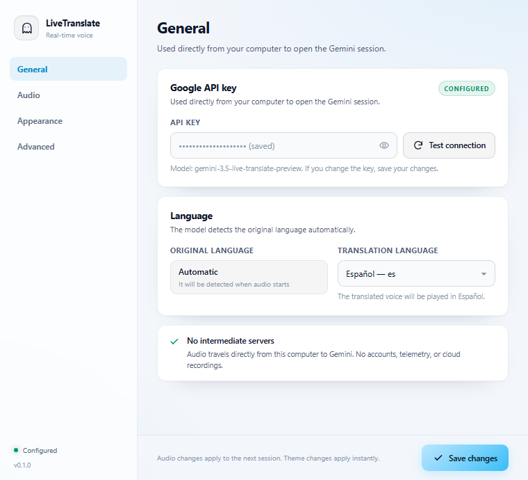

  

<h1 align="center">LiveTranslate</h1>

<strong>Traduisez l’audio système en temps réel avec Gemini Live. Une pilule flottante de 100×32, sans câble audio virtuel.</strong>

  

  
  
  
  
  

  <a href="README.md">English</a> ·
  <a href="README.zh-CN.md">简体中文</a> ·
  <a href="README.zh-TW.md">繁體中文</a> ·
  <a href="README.ko.md">한국어</a> ·
  <a href="README.de.md">Deutsch</a> ·
  <a href="README.es.md">Español</a> ·
  <strong>Français</strong> ·
  <a href="README.it.md">Italiano</a> ·
  <a href="README.da.md">Dansk</a> ·
  <a href="README.ja.md">日本語</a> ·
  <a href="README.pl.md">Polski</a> ·
  <a href="README.ru.md">Русский</a> 
  <a href="README.bs.md">Bosanski</a> ·
  <a href="README.ar.md">العربية</a> ·
  <a href="README.no.md">Norsk</a> ·
  <a href="README.pt-BR.md">Português (Brasil)</a> ·
  <a href="README.he.md">עברית</a> ·
  <a href="README.tr.md">Türkçe</a> ·
  <a href="README.uk.md">Українська</a> ·
  <a href="README.hi.md">हिन्दी</a> ·
  <a href="README.el.md">Ελληνικά</a> ·
  <a href="README.vi.md">Tiếng Việt</a>

100×32 · LiveTranslate

---

## Présentation

LiveTranslate capture le son déjà lu par votre ordinateur et le traduit en temps réel avec Gemini Live Translate. La voix traduite est lue sur la sortie choisie, directement depuis votre ordinateur et sans serveur intermédiaire.

## Fonctionnalités

- Traduction parole-à-parole en temps réel avec Gemini Live Translate.
- Pilule flottante compacte (100×32 px) : cliquez sur l’état pour démarrer/arrêter, faites glisser le fantôme et utilisez l’engrenage mini.
- Capture native de l’audio système sous Windows (WASAPI), macOS (ScreenCaptureKit) et Linux (PulseAudio/PipeWire), sans câble virtuel.
- 22 langues d’interface, thèmes clair/sombre, zone de notification, raccourci global Ctrl+Alt+T et reconnexion automatique.
- La clé API reste dans le trousseau du système ; l’audio va directement à Gemini, sans compte ni télémétrie.

## Installation

Téléchargez la dernière version depuis [GitHub Releases](https://github.com/sergio-dev1-py/translate-live/releases/latest). Les builds ne sont pas signés ; SmartScreen ou Gatekeeper peut demander une confirmation.

| Plateforme | Fichier |
|---|---|
| Windows 10/11 | <code>LiveTranslate_&lt;version&gt;_x64-setup.exe</code> |
| macOS 13+ | <code>LiveTranslate_&lt;version&gt;_universal.dmg</code> |
| Linux | .AppImage / .deb |

## Démarrage rapide

1. Installez et ouvrez LiveTranslate ; la pilule apparaît au-dessus de la barre des tâches.
2. Créez une clé API sur [Google AI Studio](https://aistudio.google.com/apikey), collez-la dans Paramètres → Général, testez la connexion et enregistrez.
3. Dans Audio, choisissez la capture et la sortie. Lancez un audio et cliquez sur <code>AUTO→ES</code> ; le point vert indique le direct. Ctrl+Alt+T démarre ou arrête aussi.

## Confidentialité

La clé API est stockée uniquement dans le trousseau du système et n’est jamais transmise au frontend. L’audio va directement à Gemini ; aucun serveur LiveTranslate, compte, télémétrie ou enregistrement. Ne commitez jamais de clé ni de fichier .env.

## Plateformes

| Plateforme | Capture | État |
|---|---|---|
| Windows 10/11 | WASAPI loopback | Testé sous Windows 10 21H2 |
| macOS 13+ | ScreenCaptureKit | Implémenté ; build CI ; test manuel en attente |
| Linux | PulseAudio / PipeWire | Implémenté ; build CI ; test manuel en attente |

## Compiler depuis les sources

Nécessite Node.js 22+, Rust stable et les dépendances de votre plateforme. Les détails macOS/Linux sont dans le README anglais.

    git clone https://github.com/sergio-dev1-py/translate-live.git
    cd translate-live
    npm ci
    npm run tauri dev

## Dépannage

- Aucune sortie : rebranchez le périphérique, cliquez sur Actualiser puis sélectionnez-le dans Audio.
- macOS : accordez l’autorisation Screen & System Audio Recording et redémarrez l’application.
- Linux : installez PulseAudio ou PipeWire avec pipewire-pulse et libpulse.

## Licence

MIT — voir [LICENSE](LICENSE).

> [Documentation complète en anglais](README.md).

---

  <a href="README.md">English</a> ·
  <a href="README.zh-CN.md">简体中文</a> ·
  <a href="README.zh-TW.md">繁體中文</a> ·
  <a href="README.ko.md">한국어</a> ·
  <a href="README.de.md">Deutsch</a> ·
  <a href="README.es.md">Español</a> ·
  <strong>Français</strong> ·
  <a href="README.it.md">Italiano</a> ·
  <a href="README.da.md">Dansk</a> ·
  <a href="README.ja.md">日本語</a> ·
  <a href="README.pl.md">Polski</a> ·
  <a href="README.ru.md">Русский</a> 
  <a href="README.bs.md">Bosanski</a> ·
  <a href="README.ar.md">العربية</a> ·
  <a href="README.no.md">Norsk</a> ·
  <a href="README.pt-BR.md">Português (Brasil)</a> ·
  <a href="README.he.md">עברית</a> ·
  <a href="README.tr.md">Türkçe</a> ·
  <a href="README.uk.md">Українська</a> ·
  <a href="README.hi.md">हिन्दी</a> ·
  <a href="README.el.md">Ελληνικά</a> ·
  <a href="README.vi.md">Tiếng Việt</a>

